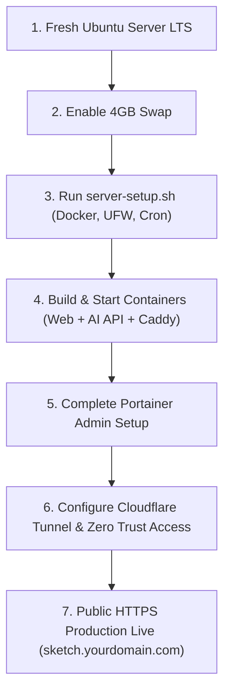

# Master Deployment Guide: From Fresh Ubuntu Server to Cloudflare Production

This is the definitive, battle-tested production manual for deploying **Sketch Video Studio** on a locally hosted or cloud Ubuntu Server LTS (24.04 / 26.04) from a blank operating system install all the way to a hardened, monitored, backed-up production deployment accessible worldwide via Cloudflare.



---

## PART 1: Initial Server Setup (On the Ubuntu Server)

### 1. Update OS & Enable 4GB Swap Space
*Crucial: Enables your server to handle heavy Python/AI wheel builds without running out of memory (OOM).*

```bash
# 1. Update all system packages
sudo apt update && sudo apt full-upgrade -y
sudo apt install -y git curl ca-certificates

# 2. Allocate and activate a 4GB swapfile
sudo fallocate -l 4G /swapfile
sudo chmod 600 /swapfile
sudo mkswap /swapfile
sudo swapon /swapfile
echo '/swapfile none swap sw 0 0' | sudo tee -a /etc/fstab

# 3. Verify swap is active
free -h
```

---

### 2. Clone the Repository into `/opt/sketch-studio`

```bash
sudo mkdir -p /opt/sketch-studio
sudo chown "$USER:$USER" /opt/sketch-studio
git clone https://github.com/ndlovumandla/image-to-animation-offline.git /opt/sketch-studio
cd /opt/sketch-studio
```

---

### 3. Run the Automated Server Setup Script

```bash
cd /opt/sketch-studio
sudo bash infrastructure/scripts/server-setup.sh --apply-firewall
newgrp docker
```

**What this automatically configures:**
- Installs **Docker Engine** and **Docker Compose v2** from Docker's official repository.
- Configures `/etc/docker/daemon.json` log rotation (`10m` × 3).
- Creates `/etc/sketch-studio/app.env`, `/var/backups/sketch-studio`, and `/var/log/sketch-studio`.
- Sets up the `edge_proxy` Docker bridge network.
- Hardens SSH (`/etc/ssh/sshd_config.d/99-sketch-hardening.conf`) and enables the UFW firewall.
- Installs automated cron jobs (health check every 5 mins, backups nightly at 02:15 UTC, restore verification weekly).

---

### 4. Open Firewall Ports for Local Network (LAN) Access

```bash
sudo ufw allow 8880/tcp comment 'Sketch Web LAN'
sudo ufw allow 9443/tcp comment 'Portainer LAN'
sudo ufw status
```

---

## PART 2: Build & Start the Production Stack

```bash
cd /opt/sketch-studio

# 1. Start the Infrastructure Services (Caddy Reverse Proxy + Portainer CE)
docker compose --env-file /etc/sketch-studio/app.env -f docker/compose.infra.yaml up -d

# 2. Build the application images sequentially (conserves CPU/RAM)
docker compose --env-file /etc/sketch-studio/app.env -f docker/compose.yaml -f docker/compose.prod.yaml build sketch-web
docker compose --env-file /etc/sketch-studio/app.env -f docker/compose.yaml -f docker/compose.prod.yaml build sketch-bg-api

# 3. Start the application stack
docker compose --env-file /etc/sketch-studio/app.env -f docker/compose.yaml -f docker/compose.prod.yaml up -d

# 4. Run the automated 10-point health check
bash infrastructure/scripts/health-check.sh
```

You should see:
```text
OVERALL STATUS: HEALTHY (0 failures)
```

---

## PART 3: Accessing Portainer & Initial Admin Setup

1. On your workstation/PC browser, open:
   👉 **`https://<YOUR_SERVER_IP>:9443`** (e.g. `https://192.168.0.52:9443`)
   *(Your browser will show a self-signed certificate warning; click Advanced -> Proceed)*.
2. If it displays *Portainer instance timed out for security purposes*, run:
   ```bash
   docker restart sketch-portainer
   ```
   and immediately refresh `https://<YOUR_SERVER_IP>:9443` within 5 minutes.
3. Set your **Admin Username** and a strong **Password** (minimum 12 characters).
4. Click **Get Started -> local environment** to view live container CPU, RAM, logs, and health metrics in real time.

---

## PART 4: Setting Up Cloudflare (Internet Access Without Port Forwarding)

You do **not** need to open ports 80 or 443 on your router or expose your public IP address.

### Step 4.1: Create a Cloudflare Tunnel
1. Log into the [Cloudflare Zero Trust Dashboard](https://one.dash.cloudflare.com/) (Free plan).
2. Navigate to **Networks -> Tunnels** -> Click **Create a tunnel**.
3. Choose **Cloudflared**, name it `ubuntu-server`, and click **Save tunnel**.
4. In the installation steps, copy the **Tunnel Token** (the string starting with `eyJhIjoi...`).

### Step 4.2: Configure Public Hostnames in the Tunnel
In your tunnel's **Public Hostname** tab, add two routes:

| Hostname | Service Type | URL | Purpose |
|---|---|---|---|
| `sketch.yourdomain.com` | `HTTP` | `sketch-caddy:80` | Main Web Application |
| `portainer.yourdomain.com` | `HTTP` | `sketch-caddy:80` | Portainer Management UI |

### Step 4.3: Protect Portainer with Cloudflare Zero Trust Access (Mandatory)
Prevent anyone on the internet from reaching Portainer without passing multi-factor authentication:
1. In Cloudflare Zero Trust, navigate to **Access -> Applications** -> Click **Add an application** -> **Self-hosted**.
2. **Application name**: `Portainer Management`
3. **Application domain**: `portainer.yourdomain.com`
4. Add an **Allow Policy**:
   - **Action**: `Allow`
   - **Include**: `Emails` -> enter your administrator email address.
5. Save the application. Now visitors must enter a one-time PIN sent to your email before Cloudflare routes them to Portainer.

---

### Step 4.4: Activate the Cloudflare Tunnel on Your Ubuntu Server

Open the environment configuration file on your server:
```bash
sudo nano /etc/sketch-studio/app.env
```

Update it with your real domain names and the tunnel token you copied:
```ini
APP_VERSION=0.1.0
APP_DOMAIN=sketch.yourdomain.com
PORTAINER_DOMAIN=portainer.yourdomain.com
VITE_BG_API_BASE=
MAX_UPLOAD_BYTES=20971520
ALLOWED_ORIGINS=https://sketch.yourdomain.com,http://localhost:8880,http://192.168.0.52:8880
CADDY_HTTP_PORT=8880
TUNNEL_TOKEN=eyJhIjoi...paste_your_cloudflare_token_here...
```
*(Save with `Ctrl+O`, `Enter`, and exit with `Ctrl+X`)*.

Start the Cloudflare Tunnel container:
```bash
cd /opt/sketch-studio
docker compose --env-file /etc/sketch-studio/app.env -f docker/compose.infra.yaml --profile tunnel up -d --force-recreate
docker compose --env-file /etc/sketch-studio/app.env -f docker/compose.yaml -f docker/compose.prod.yaml up -d
```

**Your application is now live worldwide over HTTPS at `https://sketch.yourdomain.com`!**

---

## PART 5: Ongoing Operations & Routine Commands

| Task | Command |
|---|---|
| **Health Check** | `bash /opt/sketch-studio/infrastructure/scripts/health-check.sh` |
| **Live Resource Monitor** | `docker stats` |
| **Inspect Web Access Logs** | `tail -f /var/log/sketch-studio/access.log` |
| **Inspect Automated Cron Logs** | `tail -f /var/log/sketch-studio/health.log`<br>`tail -f /var/log/sketch-studio/backup.log` |
| **Run Manual Backup** | `bash /opt/sketch-studio/infrastructure/scripts/backup.sh` |
| **Test Restore Integrity** | `bash /opt/sketch-studio/infrastructure/scripts/restore-test.sh` |
| **Deploy a New Git Version** | `git pull && bash /opt/sketch-studio/infrastructure/scripts/deploy.sh 0.1.1` |
| **Instant Rollback** | `bash /opt/sketch-studio/infrastructure/scripts/rollback.sh` |
