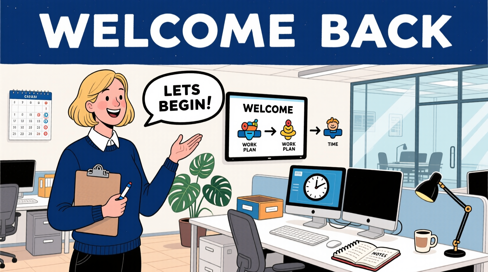
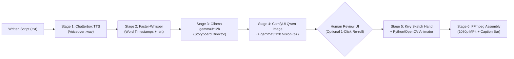

# AI Explainer & Whiteboard Sketch Studio (100% Offline, Local AI)

[](https://github.com/ndlovumandla/image-to-animation-offline/actions/workflows/ci.yml)
[](LICENSE)
[](https://www.python.org/)
[](#local-ai--tools-stack)

**Turn any written training or explainer script into a narrated, hand-drawn whiteboard animation video — completely offline on your own computer or GPU server, with zero per-video cloud fees.**

Built on top of the open-source Kivy Offline Image-to-Animation engine, this project adds a complete **6-stage Local AI Video Production Pipeline** and **Web Studio UI**: natural AI voiceover, word-level audio alignment, intelligent storyboard direction, high-resolution scene illustration with automated Vision QA, whole-object hand-drawn animation synced to narration, and clean FFmpeg video assembly with non-overlapping captions.

---

## Output Video Showcase

### Animated Whiteboard Sketch Preview


> **Watch / Download Sample Output Video (MP4 with Voiceover & Captions):**
> [sample_explainer_clip.mp4](docs/showcase/sample_explainer_clip.mp4)

### Generated Scene Examples (1664×928 Native 16:9)
| Scene 1 — Consistent Presenter & Office World | Scene 2 — Concept Diagram & Uniform Banner Text |
| :---: | :---: |
|  |  |

---

## How the System Works (6-Stage Architecture)



Each GPU stage automatically **unloads its VRAM** when finished, allowing the entire pipeline to run reliably on a single **16 GB VRAM GPU** (e.g. RTX 5060 Ti / RTX 4060 Ti 16 GB / RTX 4080).

---

## Local AI & Tools Stack

| Stage / Role | Tool / Local AI Model | What It Does |
| :--- | :--- | :--- |
| **Stage 1 — Voiceover** | **Chatterbox TTS** *(Local AI)* | Synthesizes natural paragraph-chunked narration with 29+ voices, voice cloning, and tone/speed controls. |
| **Stage 2 — Word Timing** | **Faster-Whisper** *(Local AI)* | Generates exact word-level timestamps (`alignment.json`) and synced subtitles (`captions.srt`). |
| **Stage 3 — Creative Director** | **Ollama (`gemma3:12b`)** *(Local Vision + Text AI)* | Plans visual beats, consistent presenter framing, rich real-world environments, and speech bubble text. |
| **Stage 4 — Scene Illustrator & QA** | **ComfyUI + Qwen-Image (8-step Lightning / 20-step)** + **`gemma3:12b` Vision Critic** | Draws crisp 1664×928 scenes and automatically OCR-verifies banner text & spelling, auto-rerolling flawed images. |
| **Stage 5 — Whiteboard Animator** | **Kivy Image-to-Sketch Assets + Python/OpenCV Whole-Object Animator** | Segments complete people and objects (never slicing characters in half) and animates a drawing hand in sync with spoken phrases. |
| **Stage 6 — Final Video Editor** | **FFmpeg** | Joins animated clips with narration and places subtitles in a dedicated dark bar below the canvas (1920×1080 MP4, zero overlap). |
| **Studio Control Panel** | **FastAPI + Single-Page Web UI** (`pipeline/web_ui.py`) | Browser studio with live GPU VRAM monitor, 24 character presets, voice preview, live scene gallery, and 1-click Re-roll. |

---

## Quickstart — Fork & Run Locally

### Prerequisites
- **Python 3.11 or 3.12**
- **FFmpeg & FFprobe** installed and available on your `PATH`
- **Local AI Services** (for full 6-stage video generation; runs on `127.0.0.1` by default):
  - **Ollama** (`http://127.0.0.1:11434`) with `ollama pull gemma3:12b`
  - **ComfyUI** (`http://127.0.0.1:8188`) with Qwen-Image FP8/INT8 + Lightning LoRA
  - **Chatterbox TTS Server** (`http://127.0.0.1:8004`)
  - *(Ubuntu GPU server helper script included at `pipeline/setup_gpu_server.sh`)*

### 1. Fork & Clone
```bash
git clone https://github.com/ndlovumandla/image-to-animation-offline.git
cd image-to-animation-offline
```

### 2. Create Virtual Environment & Install Dependencies
```bash
python -m venv .venv

# Linux / macOS:
source .venv/bin/activate
# Windows (PowerShell):
.\.venv\Scripts\Activate.ps1

pip install --upgrade pip
pip install -r pipeline/requirements.txt
```

### 3. Configure Environment Variables (Optional)
Copy `.env.example` to `.env` if your AI services run on a different machine or custom ports. By default, everything connects to `127.0.0.1`:
```bash
cp .env.example .env
```

Key environment variables:
| Variable | Default | Description |
| :--- | :--- | :--- |
| `SKETCH_GPU_HOST` | `127.0.0.1` | Hostname or IP running Chatterbox, Ollama, and ComfyUI |
| `CHATTERBOX_URL` | `http://127.0.0.1:8004` | Chatterbox TTS API URL |
| `OLLAMA_URL` | `http://127.0.0.1:11434` | Ollama API URL |
| `COMFYUI_URL` | `http://127.0.0.1:8188` | ComfyUI API URL |
| `SKETCH_RUNS_DIR` | `./runs` | Directory where generated projects and MP4s are saved |
| `FFMPEG_BIN` | `ffmpeg` | Path to `ffmpeg` executable |
| `FFPROBE_BIN` | `ffprobe` | Path to `ffprobe` executable |

### 4. Launch the Web Studio UI
```bash
uvicorn pipeline.web_ui:app --host 0.0.0.0 --port 8090
```
Open **`http://localhost:8090`** in your browser:
1. Paste your training or explainer script.
2. Pick a **Chatterbox Voice** (preview it directly in the UI) and choose a **Presenter Character**, **Environment**, and **Banner Palette**.
3. Click **Generate Video** — watch scenes appear live, click **Re-roll** on any slide you want regenerated, then click **Approve & Animate** to render the final 1080p MP4.

### 5. Or Run via Command Line (CLI)
```bash
python -m pipeline.run_pipeline \
  --script my_script.txt \
  --output-dir ./runs/my_video \
  --gpu-host 127.0.0.1 \
  --voice Fiona.wav \
  --ollama-model gemma3:12b \
  --burn-captions
```
Supports crash-safe resume with `--from-stage N --to-stage M` (`1` through `6`).

---

## Standalone Kivy Image-to-Animation Desktop App
You can still run the original lightweight offline Kivy app to turn any single image (or folder of images) into a whiteboard sketch video without any AI services:
```bash
cd kivy
pip install -r requirements.txt
python main.py
```

---

## Running Automated Tests Locally
The test suite runs **100% offline without a GPU or external AI services**, validating configuration, character presets, prompt compilation, workflow JSONs, whole-object animation rendering, and FastAPI Web Studio endpoints:
```bash
pip install pytest httpx
pytest tests/test_pipeline.py -v
```

---

## Repository Structure
```text
├── pipeline/                  # 6-Stage Local AI Video Sketch Studio
│   ├── config.py              # Central portable configuration (defaults to 127.0.0.1)
│   ├── characters.py          # 24 diverse presenter presets, palettes & environments
│   ├── stage1_tts.py          # Paragraph-chunked Chatterbox TTS + VRAM unload
│   ├── stage2_whisper.py      # Faster-Whisper word-level alignment + SRT
│   ├── stage3_director.py     # Batched Ollama Visual Director + prompt compiler
│   ├── stage4_comfyui.py      # ComfyUI Qwen-Image client + Vision Auto-QA Critic
│   ├── stage5_animate.py      # Whole-object whiteboard hand animator (OpenCV)
│   ├── stage6_assemble.py     # FFmpeg 1080p assembly + non-overlapping caption bar
│   ├── web_ui.py              # FastAPI backend & job orchestrator
│   ├── ui/index.html          # Web Studio UI
│   ├── workflows/             # ComfyUI Qwen-Image Lightning & Standard JSON workflows
│   └── requirements.txt       # Pipeline & Web Studio Python dependencies
├── kivy/                      # Standalone Kivy Offline Image-to-Animation App + hand sprites
├── tests/                     # Offline pytest suite (run automatically in GitHub Actions)
├── docs/showcase/             # Demo GIF, sample MP4 clip, and generated scene previews
├── .github/workflows/         # GitHub Actions CI & CD workflows
└── LICENSE                    # MIT License
```

---

## Contributing & License
Pull requests, new character presets, workflow improvements, and bug fixes are welcome! Please run `pytest tests/test_pipeline.py -v` before opening a PR.

- Licensed under the **MIT License** — see [LICENSE](LICENSE).
- Built upon the open-source Kivy image-to-animation foundation by [daslearning-org/image-to-animation-offline](https://github.com/daslearning-org/image-to-animation-offline).
