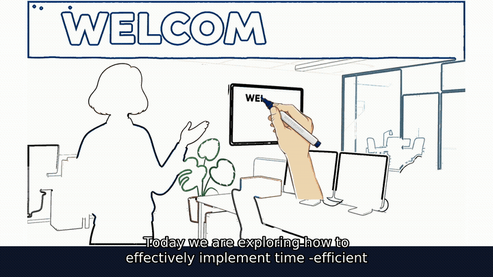
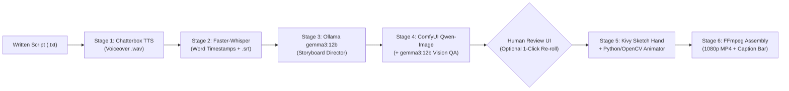

# AI Explainer & Whiteboard Sketch Studio (100% Offline, Local AI)

[](https://github.com/ndlovumandla/image-to-animation-offline/actions/workflows/ci.yml)
[](LICENSE)
[](https://www.python.org/)
[](#local-ai--tools-stack)

**Turn any written training or explainer script into a narrated, hand-drawn whiteboard animation video — completely offline on your own computer or GPU server, with zero per-video cloud fees.**

Built on top of the open-source Kivy Offline Image-to-Animation engine, this project adds a complete **6-stage Local AI Video Production Pipeline** and **Web Studio UI**: natural AI voiceover, word-level audio alignment, intelligent storyboard direction, high-resolution scene illustration with automated Vision QA, whole-object hand-drawn animation synced to narration, and clean FFmpeg video assembly with non-overlapping captions.

---

## Output Video Showcase

### Animated Whiteboard Sketch Preview


> **Watch / Download Sample Output Video (MP4 with Voiceover & Captions):**
> [sample_explainer_clip.mp4](docs/showcase/sample_explainer_clip.mp4)

### Generated Scene Examples (1664×928 Native 16:9)
| Scene 1 — Consistent Presenter & Office World | Scene 2 — Concept Diagram & Uniform Banner Text |
| :---: | :---: |
|  |  |

---

## How the System Works (6-Stage Architecture)



Each GPU stage automatically **unloads its VRAM** when finished, allowing the entire pipeline to run reliably on a single **16 GB VRAM GPU** (e.g. RTX 5060 Ti / RTX 4060 Ti 16 GB / RTX 4080).

---

## Local AI & Tools Stack

| Stage / Role | Tool / Local AI Model | What It Does |
| :--- | :--- | :--- |
| **Stage 1 — Voiceover** | **Chatterbox TTS** *(Local AI)* | Synthesizes natural paragraph-chunked narration with 29+ voices, voice cloning, and tone/speed controls. |
| **Stage 2 — Word Timing** | **Faster-Whisper** *(Local AI)* | Generates exact word-level timestamps (`alignment.json`) and synced subtitles (`captions.srt`). |
| **Stage 3 — Creative Director** | **Ollama (`gemma3:12b`)** *(Local Vision + Text AI)* | Plans visual beats, consistent presenter framing, rich real-world environments, and speech bubble text. |
| **Stage 4 — Scene Illustrator & QA** | **ComfyUI + Qwen-Image (8-step Lightning / 20-step)** + **`gemma3:12b` Vision Critic** | Draws crisp 1664×928 scenes and automatically OCR-verifies banner text & spelling, auto-rerolling flawed images. |
| **Stage 5 — Whiteboard Animator** | **Kivy Image-to-Sketch Assets + Python/OpenCV Whole-Object Animator** | Segments complete people and objects (never slicing characters in half) and animates a drawing hand in sync with spoken phrases. |
| **Stage 6 — Final Video Editor** | **FFmpeg** | Joins animated clips with narration and places subtitles in a dedicated dark bar below the canvas (1920×1080 MP4, zero overlap). |
| **Studio Control Panel** | **FastAPI + Single-Page Web UI** (`pipeline/web_ui.py`) | Browser studio with live GPU VRAM monitor, 24 character presets, voice preview, live scene gallery, and 1-click Re-roll. |

---

## System Requirements

Because the pipeline automatically **unloads each AI model from GPU memory (VRAM)** before starting the next stage, you do **not** need a datacenter GPU — a single 16 GB consumer GPU runs the entire 6-stage studio end-to-end.

| Component | Minimum (Full 6-Stage AI Studio) | Recommended (Fast Production) | Standalone Kivy Image-to-Sketch App Only |
| :--- | :--- | :--- | :--- |
| **Operating System** | Ubuntu 22.04/24.04, Windows 10/11, or macOS | Ubuntu 22.04/24.04 LTS (native CUDA) | Windows, Linux, macOS, or Android |
| **GPU & VRAM** | NVIDIA GPU with **12–16 GB VRAM** (CUDA 12.1+) | NVIDIA RTX 4060 Ti 16 GB / **RTX 5060 Ti 16 GB** / RTX 4080+ | Any GPU or **CPU only** (no AI needed) |
| **System RAM** | 16 GB RAM | **32 GB RAM** | 4 GB RAM |
| **Free Disk Space** | ~40 GB (for local AI models + outputs) | **60+ GB SSD** | < 1 GB |
| **CPU** | 4+ cores | 8+ cores (speeds up Stage 5 parallel animation) | Dual-core+ |
| **Software** | Python 3.11 or 3.12, Git, FFmpeg & FFprobe | Python 3.12, Git, FFmpeg, NVIDIA drivers | Python 3.11/3.12 |

> **No GPU?** You can still run the **Standalone Kivy Desktop App** (turns any existing image into a hand-drawn whiteboard video on CPU) and the **offline test suite** (`pytest`) on any normal laptop.

---

## Quickstart — 1-Click Setup (Beginner-Friendly Guide)

### Fast Path: Run the 1-Click Setup Script
After cloning your fork (`git clone https://github.com/<YOUR-USERNAME>/image-to-animation-offline.git && cd image-to-animation-offline`):

- **Linux / macOS (1-click install + launch):**
  ```bash
  chmod +x setup.sh
  ./setup.sh --start
  ```
  *(Want it to also download Ollama `gemma3:12b` and install ComfyUI + Qwen-Image models automatically? Run `./setup.sh --with-ai --start`!)*

- **Windows 10 / 11 (PowerShell — 1-click install + launch):**
  ```powershell
  powershell -ExecutionPolicy Bypass -File .\setup.ps1 -Start
  ```

The 1-click script automatically checks Python & FFmpeg, creates `.venv`, installs all dependencies, creates `.env`, verifies your installation, checks whether Ollama / ComfyUI / Chatterbox are online, and opens the Web Studio at **`http://localhost:8090`**.

---

### Manual Step-by-Step Setup (If You Prefer Doing Each Step Yourself)

Follow these 6 steps in order. If you already have Git, Python, and FFmpeg installed, you can skip straight to **Step 2**.

### Step 1: Install Base Tools (Git, Python 3.12, FFmpeg)

<details open>
<summary><strong>Ubuntu / Debian Linux</strong></summary>

```bash
sudo apt update
sudo apt install -y git python3.12 python3.12-venv python3-pip ffmpeg curl
```
</details>

<details>
<summary><strong>Windows 10 / 11 (PowerShell)</strong></summary>

```powershell
winget install Git.Git
winget install Python.Python.3.12
winget install Gyan.FFmpeg
```
*(Close and reopen PowerShell after installing so `git`, `python`, and `ffmpeg` are on your `PATH`.)*
</details>

<details>
<summary><strong>macOS (Homebrew)</strong></summary>

```bash
brew install git python@3.12 ffmpeg
```
</details>

Verify they work:
```bash
git --version && python3 --version && ffmpeg -version | head -n 1
```

---

### Step 2: Fork & Clone This Repository
1. Click the **Fork** button at the top-right of this GitHub page to copy the repo to your own GitHub account.
2. Clone your fork to your computer:
```bash
git clone https://github.com/<YOUR-GITHUB-USERNAME>/image-to-animation-offline.git
cd image-to-animation-offline
```

---

### Step 3: Install the Video Studio Python Dependencies
Create an isolated virtual environment so nothing conflicts with your system Python:
```bash
python3 -m venv .venv

# Activate it:
# Linux / macOS:
source .venv/bin/activate
# Windows (PowerShell):
.\.venv\Scripts\Activate.ps1

# Install all Studio & Pipeline dependencies:
pip install --upgrade pip
pip install -r pipeline/requirements.txt
```

---

### Step 4: Start the 3 Local AI Services (One-Time Setup)
The studio talks to three local AI servers on your machine (`127.0.0.1` by default). Keep each one running in its own terminal (or as a background service):

1. **Ollama (Creative Director + Vision Quality Inspector — port `11434`)**
   - Install from [ollama.com](https://ollama.com/download) (or on Linux: `curl -fsSL https://ollama.com/install.sh | sh`).
   - Download the vision + text model:
     ```bash
     ollama pull gemma3:12b
     ```
2. **ComfyUI (Scene Illustrator — port `8188`)**
   - Clone [ComfyUI](https://github.com/comfyanonymous/ComfyUI) and install its requirements, then place the Qwen-Image models in ComfyUI's `models/` folders:
     - `models/diffusion_models/qwen_image_fp8_e4m3fn.safetensors`
     - `models/text_encoders/qwen_2.5_vl_7b_fp8_scaled.safetensors`
     - `models/vae/qwen_image_vae.safetensors`
     - `models/loras/Qwen-Image-Lightning-8steps-V2.0-bf16.safetensors` *(for fast 8-step generation)*
   - Start ComfyUI with low-VRAM offloading enabled:
     ```bash
     python main.py --listen 0.0.0.0 --port 8188 --lowvram
     ```
   - *(On Ubuntu, you can also inspect `pipeline/setup_gpu_server.sh` for a reference server setup.)*
3. **Chatterbox TTS Server (Voiceover Narrator — port `8004`)**
   - Run [Chatterbox TTS Server](https://github.com/devnen/Chatterbox-TTS-Server) on port `8004` (`http://127.0.0.1:8004`).

---

### Step 5: Verify All 3 Local AI Services Are Ready
Run this quick check before opening the Studio:
```bash
curl -s http://127.0.0.1:11434/api/tags | head -c 120 && echo ""
curl -s -o /dev/null -w "ComfyUI HTTP: %{http_code}\n" http://127.0.0.1:8188/system_stats
curl -s http://127.0.0.1:8004/health && echo ""
```
You should see `gemma3:12b` listed by Ollama, `ComfyUI HTTP: 200`, and `{"status":"healthy",...}` from Chatterbox.

*(Optional)* If your AI services run on a separate GPU server on your network instead of `127.0.0.1`, copy `.env.example` to `.env` or set `SKETCH_GPU_HOST`:
```bash
cp .env.example .env
# Example: export SKETCH_GPU_HOST=192.168.1.50
```

| Variable | Default | Description |
| :--- | :--- | :--- |
| `SKETCH_GPU_HOST` | `127.0.0.1` | Hostname or IP running Chatterbox, Ollama, and ComfyUI |
| `CHATTERBOX_URL` | `http://127.0.0.1:8004` | Chatterbox TTS API URL |
| `OLLAMA_URL` | `http://127.0.0.1:11434` | Ollama API URL |
| `COMFYUI_URL` | `http://127.0.0.1:8188` | ComfyUI API URL |
| `SKETCH_RUNS_DIR` | `./runs` | Folder where generated projects and MP4 videos are saved |
| `FFMPEG_BIN` | `ffmpeg` | Path to `ffmpeg` executable |
| `FFPROBE_BIN` | `ffprobe` | Path to `ffprobe` executable |

---

### Step 6: Launch the Web Studio UI & Create Your First Video!
Make sure your `.venv` is activated, then run:
```bash
uvicorn pipeline.web_ui:app --host 0.0.0.0 --port 8090
```
Open **`http://localhost:8090`** in your browser:
1. **Paste your script** into the script box (even a short 3-sentence paragraph is great for your first test).
2. **Pick a Voice** in *Chatterbox Voice & Audio Controls* and click **Preview Voice** to hear it.
3. **Pick a Presenter Character, Environment, and Banner Palette** (24 built-in presets).
4. Click **Generate Video**:
   - Watch each scene appear live as ComfyUI generates and `gemma3:12b` inspects it.
   - Click **Re-roll** on any slide you want regenerated.
   - Click **Approve & Animate** to draw every scene with the whiteboard hand and export your final 1080p MP4!

#### Alternative: Run via Command Line (CLI)
```bash
python -m pipeline.run_pipeline \
  --script my_script.txt \
  --output-dir ./runs/my_video \
  --gpu-host 127.0.0.1 \
  --voice Fiona.wav \
  --ollama-model gemma3:12b \
  --burn-captions
```
Supports crash-safe resume with `--from-stage N --to-stage M` (`1` through `6`).

---

### Beginner Troubleshooting

| Problem | Quick Fix |
| :--- | :--- |
| `ffmpeg: command not found` | Install FFmpeg (Step 1) and restart your terminal, or set `FFMPEG_BIN=/full/path/to/ffmpeg`. |
| `Address already in use` on port `8090` | Another app is using port 8090 — launch with `--port 8091` instead. |
| `Connection refused` to port `8004`, `8188`, or `11434` | One of the 3 local AI services isn't running yet. Re-run the Step 5 `curl` check to see which one is offline. |
| GPU runs out of memory (CUDA OOM) | Make sure ComfyUI was started with `--lowvram`, and verify no other heavy GPU app is holding VRAM open. |
| `ModuleNotFoundError: No module named 'pipeline'` | Run commands from the repository root folder (`image-to-animation-offline/`) with your `.venv` activated. |

---

## Standalone Kivy Image-to-Animation Desktop App
You can still run the original lightweight offline Kivy app to turn any single image (or folder of images) into a whiteboard sketch video without any AI services:
```bash
cd kivy
pip install -r requirements.txt
python main.py
```

---

## Running Automated Tests Locally
The test suite runs **100% offline without a GPU or external AI services**, validating configuration, character presets, prompt compilation, workflow JSONs, whole-object animation rendering, and FastAPI Web Studio endpoints:
```bash
pip install pytest httpx
python -m pytest tests/test_pipeline.py -v
```

---

## Repository Structure
```text
├── pipeline/                  # 6-Stage Local AI Video Sketch Studio
│   ├── config.py              # Central portable configuration (defaults to 127.0.0.1)
│   ├── characters.py          # 24 diverse presenter presets, palettes & environments
│   ├── stage1_tts.py          # Paragraph-chunked Chatterbox TTS + VRAM unload
│   ├── stage2_whisper.py      # Faster-Whisper word-level alignment + SRT
│   ├── stage3_director.py     # Batched Ollama Visual Director + prompt compiler
│   ├── stage4_comfyui.py      # ComfyUI Qwen-Image client + Vision Auto-QA Critic
│   ├── stage5_animate.py      # Whole-object whiteboard hand animator (OpenCV)
│   ├── stage6_assemble.py     # FFmpeg 1080p assembly + non-overlapping caption bar
│   ├── web_ui.py              # FastAPI backend & job orchestrator
│   ├── ui/index.html          # Web Studio UI
│   ├── workflows/             # ComfyUI Qwen-Image Lightning & Standard JSON workflows
│   └── requirements.txt       # Pipeline & Web Studio Python dependencies
├── kivy/                      # Standalone Kivy Offline Image-to-Animation App + hand sprites
├── tests/                     # Offline pytest suite (run automatically in GitHub Actions)
├── docs/showcase/             # Demo GIF, sample MP4 clip, and generated scene previews
├── .github/workflows/         # GitHub Actions CI & CD workflows
└── LICENSE                    # MIT License
```

---

## Contributing & License
Pull requests, new character presets, workflow improvements, and bug fixes are welcome! Please run `pytest tests/test_pipeline.py -v` before opening a PR.

- Licensed under the **MIT License** — see [LICENSE](LICENSE).
- Built upon the open-source Kivy image-to-animation foundation by [daslearning-org/image-to-animation-offline](https://github.com/daslearning-org/image-to-animation-offline).
