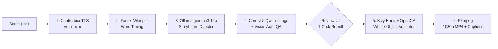

<div align="center">

# AI Explainer & Whiteboard Sketch Studio

**Turn any written script into a narrated, hand-drawn whiteboard explainer video — 100% offline on your own GPU with \$0 cloud fees.**

[](https://github.com/ndlovumandla/image-to-animation-offline/actions/workflows/ci.yml)
[](LICENSE)
[](https://www.python.org/)
[](#local-ai-stack)

<br/>


**[Watch Sample MP4 with Voiceover & Captions](docs/showcase/sample_explainer_clip.mp4)** · **[1-Click Setup](#-1-click-quickstart)** · **[System Requirements](#-system-requirements)** · **[How It Works](#-how-it-works)**

</div>

---

## Generated Scene Showcase

| Consistent Presenter & Office World | Concept Diagram & Uniform Banner Text |
| :---: | :---: |
|  |  |

---

## Why This Project?

- **100% Offline & Private** — Runs entirely on your own PC or Ubuntu server. Zero monthly subscriptions, zero watermarks, zero data sent to the cloud.
- **Runs on a Single 16 GB GPU** — Automatically unloads VRAM after every stage so Chatterbox TTS, Whisper, `gemma3:12b`, and Qwen-Image run cleanly end-to-end.
- **Vision Auto-QA Critic** — `gemma3:12b` inspects every generated slide, verifies banner spelling, and auto-rerolls flawed scenes before animation.
- **Whole-Object Hand Drawing** — Sketches complete people and objects smoothly in sync with spoken words (never slicing characters in half), with subtitles in a dedicated bar underneath.
- **Built-In Web Studio UI** — 24 diverse character presets, live scene previews, voice preview, and 1-click **Re-roll** on any slide.

---

## ⚡ 1-Click Quickstart

### Ubuntu / Linux / macOS
> *Fresh Ubuntu Server with an NVIDIA GPU? First install the NVIDIA driver once:* `sudo ubuntu-drivers install && sudo reboot`

```bash
git clone https://github.com/ndlovumandla/image-to-animation-offline.git
cd image-to-animation-offline

# Full 1-click install (Studio + Ollama gemma3:12b + ComfyUI Qwen-Image + Chatterbox) & launch:
./setup.sh --with-ai --start
```
*(Already running Ollama / ComfyUI / Chatterbox? Run `./setup.sh --start` instead.)*

### Windows 10 / 11 (PowerShell)
> *Make sure the latest [NVIDIA GPU Driver](https://www.nvidia.com/drivers), [Git](https://git-scm.com/), and [Python 3.12](https://www.python.org/) are installed.*

```powershell
git clone https://github.com/ndlovumandla/image-to-animation-offline.git
cd image-to-animation-offline

# Full 1-click install (Studio + Ollama gemma3:12b + ComfyUI Qwen-Image + Chatterbox) & launch:
powershell -ExecutionPolicy Bypass -File .\setup.ps1 -WithAI -Start
```
*(Already running the AI services? Run `powershell -ExecutionPolicy Bypass -File .\setup.ps1 -Start`.)*

Open **`http://localhost:8090`**, paste your script, pick a voice & character, and click **Generate Video**.

---

## 💻 System Requirements

| | Minimum (Full AI Studio) | Recommended | Standalone Kivy App (No AI) |
| :--- | :--- | :--- | :--- |
| **OS** | Ubuntu 22.04+, Windows 10/11, macOS | Ubuntu 22.04/24.04 LTS | Windows, Linux, macOS, Android |
| **GPU** | NVIDIA 12–16 GB VRAM (CUDA 12.1+) | RTX 4060 Ti / **RTX 5060 Ti 16 GB+** | CPU only |
| **RAM** | 16 GB | 32 GB | 4 GB |
| **Disk** | ~40 GB free | 60+ GB SSD | < 1 GB |
| **Tools** | Python 3.11–3.12, Git, FFmpeg | Auto-checked by `setup.sh` / `setup.ps1` | Python 3.11–3.12 |

---

## 🎬 How It Works



### Local AI Stack

| Stage | Tool / Model | Role |
| :---: | :--- | :--- |
| **1** | **Chatterbox TTS** | Natural voiceover (29+ voices, tone/speed sliders, voice cloning) |
| **2** | **Faster-Whisper** | Exact word-level timestamps (`alignment.json`) + subtitles (`captions.srt`) |
| **3** | **Ollama (`gemma3:12b`)** | Plans beats, consistent presenters, workplace props & speech bubbles |
| **4** | **ComfyUI (Qwen-Image Lightning)** | Draws 1664×928 scenes; `gemma3:12b` Vision Critic catches text errors |
| **5** | **Kivy Sketch Hand + OpenCV** | Whole-object whiteboard hand animation synced to spoken phrases |
| **6** | **FFmpeg** | Final 1920×1080 MP4 with non-overlapping caption bar below the canvas |

---

## 🛠️ Advanced Usage & Details

<details>
<summary><strong>Run via Command Line (CLI)</strong></summary>

```bash
python -m pipeline.run_pipeline \
  --script my_script.txt \
  --output-dir ./runs/my_video \
  --gpu-host 127.0.0.1 \
  --voice Fiona.wav \
  --ollama-model gemma3:12b \
  --burn-captions
```
Supports crash-safe resume with `--from-stage N --to-stage M` (`1`–`6`).
</details>

<details>
<summary><strong>Environment Variables (Remote GPU Server / Custom Ports)</strong></summary>

Copy `.env.example` to `.env` (created automatically by `setup.sh` / `setup.ps1`):

| Variable | Default | Purpose |
| :--- | :--- | :--- |
| `SKETCH_GPU_HOST` | `127.0.0.1` | IP/hostname running Ollama, ComfyUI & Chatterbox |
| `CHATTERBOX_URL` | `http://127.0.0.1:8004` | Chatterbox TTS endpoint |
| `OLLAMA_URL` | `http://127.0.0.1:11434` | Ollama API endpoint |
| `COMFYUI_URL` | `http://127.0.0.1:8188` | ComfyUI API endpoint |
| `SKETCH_RUNS_DIR` | `./runs` | Output directory for generated videos |
| `FFMPEG_BIN` / `FFPROBE_BIN` | `ffmpeg` / `ffprobe` | Custom FFmpeg binary paths |
</details>

<details>
<summary><strong>Standalone Kivy Image-to-Animation App (No AI Required)</strong></summary>

Turn any existing image or folder of images into a whiteboard sketch video on CPU:
```bash
cd kivy
pip install -r requirements.txt
python main.py
```
</details>

<details>
<summary><strong>Run Offline Tests (No GPU Required)</strong></summary>

```bash
pip install pytest httpx
python -m pytest tests/test_pipeline.py -v
```
</details>

<details>
<summary><strong>Quick Troubleshooting</strong></summary>

| Issue | Fix |
| :--- | :--- |
| `nvidia-smi` not found | Install NVIDIA driver (`sudo ubuntu-drivers install && sudo reboot` on Ubuntu, or NVIDIA Driver on Windows), or set `SKETCH_GPU_HOST` to a remote GPU server. |
| `ffmpeg` not found | Re-run `./setup.sh` (Linux) or `winget install Gyan.FFmpeg` (Windows) and reopen your terminal. |
| Port `8090` already in use | Start on another port: `uvicorn pipeline.web_ui:app --port 8091`. |
| CUDA Out of Memory | Ensure ComfyUI runs with `--lowvram` and no other heavy GPU process is holding VRAM. |
</details>

---

## License & Credits

- **MIT License** — see [LICENSE](LICENSE). Contributions and PRs welcome!
- Built on the open-source Kivy image-to-animation foundation by [daslearning-org/image-to-animation-offline](https://github.com/daslearning-org/image-to-animation-offline).
